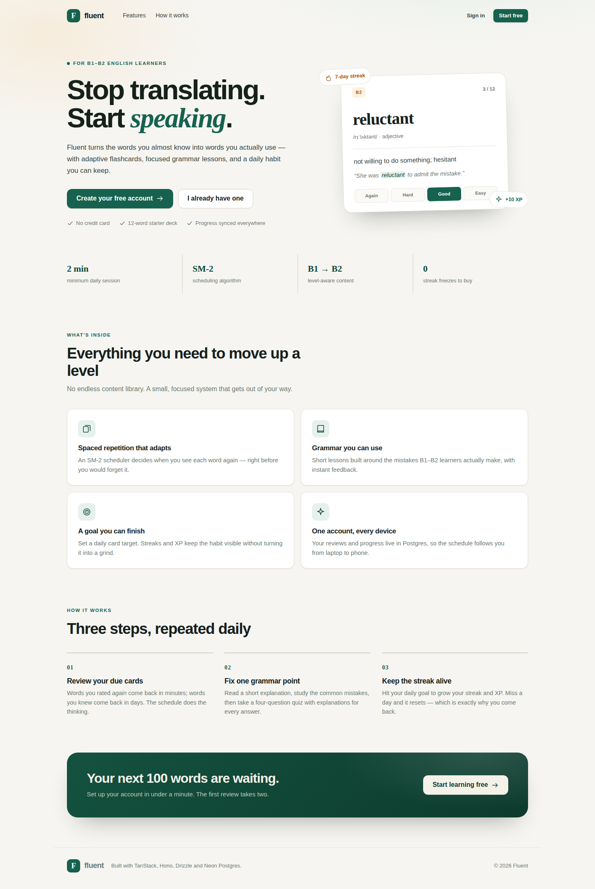
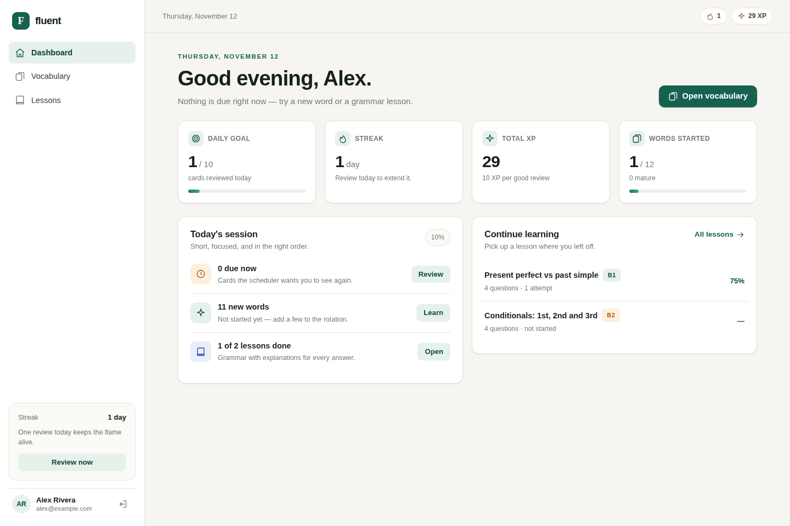
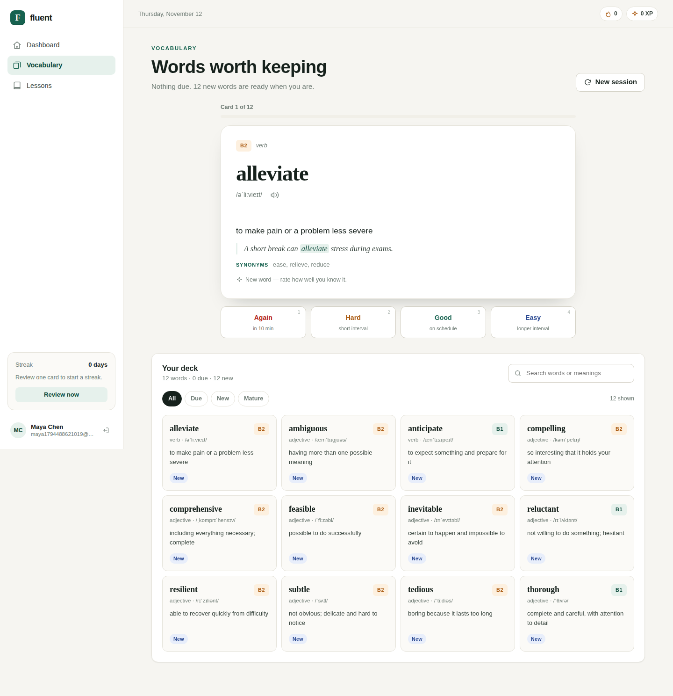

# Fluent — Web

The frontend for **Fluent**, a B1–B2 English practice platform: adaptive
vocabulary reviews, grammar lessons with explained quizzes, UK-English speaking
drills with optional phoneme scoring, dictation, a streaming conversation tutor,
XP, streaks and a daily goal.

React 19 + Vite 8 + TanStack Router (file-based) + TanStack Query, typed end to
end against the API contract.

- Backend: [`../api`](../api)
- Screenshots: [`docs/`](docs)



## Stack

| Layer | Choice | Why |
| --- | --- | --- |
| UI | React 19 + Vite 8 | Fast dev server, small production bundles |
| Routing | TanStack Router (file-based) | Type-safe routes, search params, loaders and guards |
| Server state | TanStack Query | Cache keys, invalidation after mutations, retries |
| Auth client | Better Auth React client | Cookie sessions handled by the browser |
| Validation | Zod 4 | The same schemas the API uses |
| Tests | Playwright | Real-browser auth, review, speaking, dictation and tutor flows against the real API |

## Layout

```
web/
├── docs/                    # Screenshots used by this README
├── src/
│   ├── components/          # icons, layout, UI primitives
│   ├── lib/                 # API client, auth client, queries, speech helpers
│   ├── routes/              # file-based routes
│   ├── main.tsx
│   └── styles.css
├── tests/e2e/               # Playwright specs + global setup
├── contracts.ts             # Zod contract (mirrored from ../api/contracts.ts)
├── playwright.config.ts     # starts both dev servers against fluent_test
├── tsconfig.base.json
└── vite.config.ts
```

`src/routeTree.gen.ts` is generated by the TanStack Router Vite plugin on
`npm run dev` / `npm run build`. It is committed so `npm run typecheck` works on
a fresh clone — regenerate it after adding or renaming a route.

### Routes

| Route | Purpose |
| --- | --- |
| `/` | Landing page |
| `/register`, `/login` | Auth forms; `?redirect=` is validated and honoured |
| `/app` | Protected layout: sidebar, top bar, session guard |
| `/app/dashboard` | XP, streak, daily goal, deck coverage, lesson progress |
| `/app/vocabulary` | Review session (reveal → grade) and searchable deck |
| `/app/lessons` | Lesson library |
| `/app/lessons/:slug` | Lesson content, quiz, explanations, best score |
| `/app/speaking` | UK speaking drills: model audio, mic (live or server-transcribed), phoneme feedback, opt-in recording storage |
| `/app/listening` | UK dictation: hear a clip (normal/slow), type it, word-by-word check |
| `/app/tutor` | Role-play conversation tutor with corrections and a scenario switcher |

## Quick start

The API must be running first (see [`../api`](../api)).

```bash
npm install
cp .env.example .env        # VITE_API_URL=http://localhost:8787
npm run dev
```

Open **http://localhost:5173**.

## Environment variables

Browser-visible config lives in `web/.env` and **must never contain secrets** —
Vite inlines it into the bundle:

| Variable | Description |
| --- | --- |
| `VITE_API_URL` | Base URL of the API, e.g. `http://localhost:8787` |

## Scripts

| Command | What it does |
| --- | --- |
| `npm run dev` | Vite dev server on `:5173` |
| `npm run build` | Production build into `dist/` |
| `npm run preview` | Preview the production build |
| `npm run typecheck` | Type-check the app |
| `npm run test:e2e` | Playwright auth, review, speaking and dictation flows in a real browser |
| `npm run test:e2e:ui` | Playwright interactive UI mode |

## How it works

### Data flow

```
Component
  │  useQuery(statsQuery()) / useMutation(submitReview)
  ▼
TanStack Query cache (keys: ["me"], ["stats"], ["vocabulary"], ["lessons", slug], ["speaking"], ["listening"], ["tutor", scenario])
  │
  ▼
lib/api.ts → fetch(VITE_API_URL + path, { credentials: "include" })
  │
  ▼
Hono API (../api) → Postgres
```

Query definitions live in `src/lib/queries.ts` so every screen shares the same
cache keys. After a mutation, `["vocabulary"]`, `["speaking"]`, `["listening"]`,
`["stats"]` and `["me"]` are invalidated together, so the deck, drills and
dashboard never disagree. Tutor turns invalidate only `["tutor", scenario]`.

### Speaking practice (UK English)

`/app/speaking` records the learner, uploads the clip for scoring and shows the
result word by word:

1. **Model audio** — `lib/speech.ts` uses speech synthesis with `lang: "en-GB"`
   and prefers an actual British voice. "Slower" repeats at `rate: 0.7`.
2. **Live recognition** — on Chrome/Edge, `SpeechRecognition`
   (`webkitSpeechRecognition` fallback) runs in `en-GB`; interim results stream
   into the panel.
3. **Recorded recognition** — every browser with `MediaRecorder` records the
   same take. Firefox/Safari upload it and the API transcribes it with
   `OPENAI_TRANSCRIBE_MODEL` (or Azure, when configured), so microphones work
   there too. Without either key the UI falls back to typing.
4. **WAV conversion** — the clip is decoded and re-encoded to 16 kHz mono PCM
   in the browser, which keeps Azure and Whisper happy.
5. **Feedback** — the API returns a score, matched/missed word chips and a
   coaching line. With Azure configured it also returns accuracy, fluency,
   completeness and colour-coded per-word phoneme scores; without it the UI
   says "word-accuracy mode".
6. **Storage is opt-in** — the clip is uploaded for scoring, discarded, and
   only kept when the learner ticks "Save this recording". Saved clips can be
   replayed from the result card and deleted with one click.
7. **Local playback** — the same take is available from an object URL so the
   learner can compare their accent with the model without waiting for a round
   trip.

The `GET /api/speaking` capabilities object drives the UI: the header chip says
**Phoneme scoring** when Azure is configured, and the browser note explains
whether the microphone needs a server key.

### Listening and dictation (UK English)

`/app/listening` reads each seeded clip aloud with the same `en-GB` voice:

1. **Play / Slow** — `speakBritish(text)` at `rate: 0.95` or `0.7`. There are no
   audio files to ship; the browser synthesises the clip.
2. **Type** — the learner types exactly what they heard; **Show text** reveals
   the clip for a self-check.
3. **Check** — the transcript goes to `POST /api/listening/attempt`, which scores
   it with the same word alignment as speaking and returns dictation-specific
   coaching plus XP.

### Conversation tutor

`/app/tutor` is a chat panel with five scenarios (small talk, café, interview,
travel, renting). History is stored per scenario and reloaded on visit, with a
**Start over** button that clears it.

- Replies **stream** from `POST /api/tutor/chat/stream` over server-sent events:
  `lib/queries.ts` reads the body with `ReadableStream` and appends each delta to
  a live bubble with a blinking caret.
- The header chip shows **AI tutor** when the API reports
  `provider: "openai"`, or **Local coach** when `OPENAI_API_KEY` is unset and the
  built-in British coach replies instead. A failed upstream falls back to the
  local coach mid-turn.
- After each turn the correction banner shows the tutor's fix (for example
  `apartment` → `flat`) without blocking the conversation.
- The persisted turn replaces the live bubble once the stream finishes, so the
  conversation survives a refresh.

### Auth and route protection

`src/routes/app.tsx` runs a `beforeLoad` guard:

1. `ensureQueryData(meQuery())`,
2. on a 401, redirect to `/login?redirect=<current path>`,
3. after sign-in, `login.tsx` honours the validated redirect.

Session cookies are `httpOnly` and handled by the browser — nothing is stored in
`localStorage`.

### One contract, two runtimes

`contracts.ts` defines every request and response with Zod. The web app parses
API responses with those schemas; the API validates bodies with the same ones.
**`web/contracts.ts` and `../api/contracts.ts` are intentionally separate
copies** — when you change one, change the other in the same commit.

## Testing

The Playwright suite drives the real UI, the real API and a dedicated Postgres
database (`fluent_test`). It covers:

1. sign up → review a card → XP visible on the dashboard,
2. signed-out redirect to `/login` and the redirect after sign-in,
3. sign-out clearing the session,
4. speaking drill → typed phrase → 100% score and speaking XP in the top bar,
5. dictation → show the clip text → type it → 100% and listening XP,
6. tutor → send a turn → streamed reply and an Americanism correction.

```bash
# 1. Postgres must be running (start it from ../api: npm run db:local)
# 2. Stop any running dev servers on :8787 / :5173
cd ../api && npm run db:local     # in one terminal
cd ../web && npm run test:e2e     # in another

# First time only (downloads Chromium)
npx playwright install chromium
```

`playwright.config.ts` starts **both** `../api` and this app itself, so no
separate dev terminal is required. The suites fail fast if the ports are taken.

Set `TEST_DATABASE_URL` to point the test run at a different Postgres instance.

## Build and deploy

```bash
npm run build
```

- Output: `dist/`.
- Deploy to Vercel / Netlify / Cloudflare Pages with root directory `web/`.
- Set `VITE_API_URL` to the public API URL **at build time**; Vite inlines it.
- The API must allow this origin via `WEB_ORIGIN`, and Better Auth cookies use
  `sameSite: "lax"` — host both under one parent domain (see
  [`../api`](../api#cookie-caveat)).

## Not in this slice

- Microphones in Firefox/Safari need a server-side recogniser: set
  `OPENAI_API_KEY` (transcription) or the Azure Speech keys. Without either, the
  typed fallback keeps speaking practice usable there.
- Phoneme scores require an Azure Speech resource; the app otherwise reports
  word-accuracy mode.
- Voice input for the tutor (the chat is typed), and streaming phoneme scores
  while the learner is still speaking.
- Recording storage is local disk (`AUDIO_STORAGE_DIR`); a multi-instance
  deployment needs a shared volume or an object-storage adapter.
- A CI pipeline. The suite is ready for it: run
  `npx playwright install --with-deps chromium` and `npm run test:e2e` with
  Postgres available.

## Screenshots




